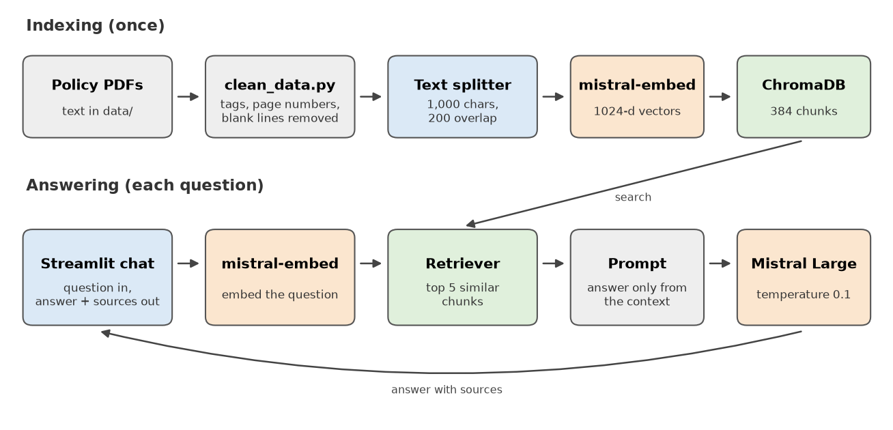

# XIM University Chatbot

[](https://github.com/Ankit02124/Our_University_Chatbot/actions/workflows/tests.yml)

A chatbot that answers student questions about XIM University's rules and policies. It uses retrieval-augmented generation (RAG): the question is matched against the university's official policy documents stored in a ChromaDB vector database, and Mistral AI writes the answer only from the matching passages. Each answer shows the passages it came from.

## Problem statement

Answers to everyday student questions (minimum attendance, how CGPA is calculated, scholarship conditions, hostel timings, guest rules) are spread across long PDF manuals that few students read end to end. The same questions reach faculty and office staff again and again. A general chatbot does not know this university's rules and will often make up a plausible answer.

This chatbot answers from the official documents only. If the documents do not cover a question, it says so instead of guessing.

## Features

- **Answers from official documents:** the UG Student Manual of Policies, the Resident Student (hostel) Policy and the Mass Communication Manual of Policies.
- **Sources with every answer:** the document name and the passage used are shown under the answer, so it can be checked.
- **No guessing:** the model is told to use only the retrieved passages and to reply "I cannot find that information in the official documents." when they don't contain the answer. Temperature is set to 0.1.
- **Saved index:** the documents are embedded once and stored in ChromaDB, so the app starts without re-embedding them.
- **Chat interface:** Streamlit chat with history, a document list and a clear button.
- **API key handling:** read from the `MISTRAL_API_KEY` environment variable or typed into the sidebar, never written to disk.
- **Tests without an API key:** cleaning, chunking and the answer step are tested with fake embedding and chat models, in GitHub Actions.

## Tech stack

| area | used |
|---|---|
| language | Python |
| LLM | Mistral AI `mistral-large-latest` |
| embeddings | Mistral AI `mistral-embed` (1024 dimensions) |
| vector database | ChromaDB |
| framework | LangChain (text splitter, Chroma integration, prompt template, LCEL chain) |
| interface | Streamlit |
| testing | pytest, GitHub Actions |

## System architecture



**Indexing (once):**

1. `clean_data.py` cleans the text extracted from the PDF manuals: removes leftover tags, page numbers and runs of blank lines.
2. The documents are split into chunks of 1,000 characters, with 200 characters of overlap so a rule is not cut in half between two chunks.
3. Each chunk is embedded with `mistral-embed` and saved in ChromaDB (`vector_db_mistral/`).

**Answering (every question):**

1. The question is embedded and the 5 most similar chunks are retrieved.
2. The chunks and the question are put into a prompt that tells the model to answer only from that context.
3. Mistral Large writes the answer, and the app shows it with its sources.

## Installation

Needs Python 3.10 or newer and a Mistral API key (from [console.mistral.ai](https://console.mistral.ai)).

```
git clone https://github.com/Ankit02124/Our_University_Chatbot.git
cd Our_University_Chatbot
python -m venv venv
venv\Scripts\activate            # Linux/macOS: source venv/bin/activate
pip install -r requirements.txt
```

## Usage

```
streamlit run app.py
```

On Windows you can also double-click `run_app.bat`. Paste your API key in the sidebar, or set it before starting the app (`set MISTRAL_API_KEY=...` on Windows, `export MISTRAL_API_KEY=...` on Linux/macOS).

Questions the documents can answer:

| question | answered from |
|---|---|
| What is the minimum attendance needed to sit the end-semester exam? | UG Manual of Policies |
| What CGPA do I need to keep my scholarship? | UG Manual of Policies |
| How are SGPA and CGPA calculated? | UG Manual of Policies |
| What are the visiting hours for guests in the hostel? | Resident Student Policy |
| Until what time can hostel residents use the library at night? | Resident Student Policy |
| What is the policy on plagiarism in the Mass Communication programme? | Mass Communication Manual |

**Adding or updating documents:** put the `.txt` file in `data/`, run `python clean_data.py`, add a readable name for it in `DOC_TITLES` in `rag.py`, delete `vector_db_mistral/` and restart the app. The index is rebuilt on the first run, which embeds every chunk once.

**Tests:**

```
pip install pytest
pytest
```

## Project structure

```
app.py                  Streamlit chat interface
rag.py                  document loading, chunking, ChromaDB index, prompt and answer step
clean_data.py           cleans the raw text in data/ into data_clean/
data/                   text extracted from the university's policy PDFs
data_clean/             cleaned text that gets indexed
vector_db_mistral/      saved ChromaDB index (384 chunks)
tests/                  pytest, runs without an API key
docs/                   architecture diagram
run_app.bat             starts the app on Windows
```

## Documents and models

| document | file | size |
|---|---|---|
| Student Manual of Policies, UG programmes (effective July 2023) | `Mop_UG_AY 2023-24.txt` | 130 KB |
| Resident Student (Hostel) Policy 2025-26 | `345_Resident_Student_Policy_2025_26_NC.txt` | 63 KB |
| Student Manual of Policies, BSc/MA Mass Communication, XCOMM (July 2020) | `MOP1.txt` | 88 KB |

About 281 KB of text in total, stored as 384 chunks of up to 1,000 characters.

| | |
|---|---|
| embedding model | `mistral-embed`, 1024-dimensional vectors |
| chat model | `mistral-large-latest`, temperature 0.1 |
| retrieval | similarity search, top 5 chunks |

The index and the questions must use the same embedding model. If you change the embedding model, delete `vector_db_mistral/` so it is rebuilt.

## Future scope

- Remember the conversation so follow-up questions work ("and for hostel students?").
- Load the PDFs directly and keep page numbers, so answers can cite the page.
- Hybrid search (keywords plus vectors) for exact terms such as course codes.
- A set of test questions with known answers to measure accuracy after each change.
- More documents: fee structure, academic calendar, placement policy.
- Deploy on Streamlit Community Cloud or the university intranet.

## License

MIT ([LICENSE](LICENSE)). The policy documents belong to XIM University.
